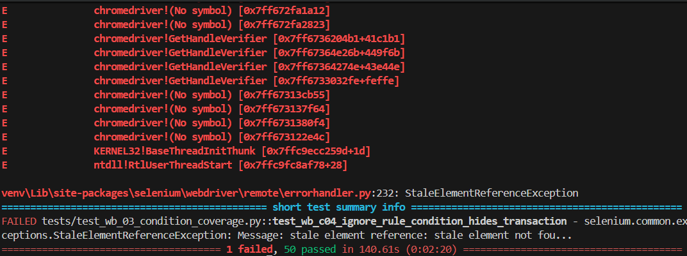
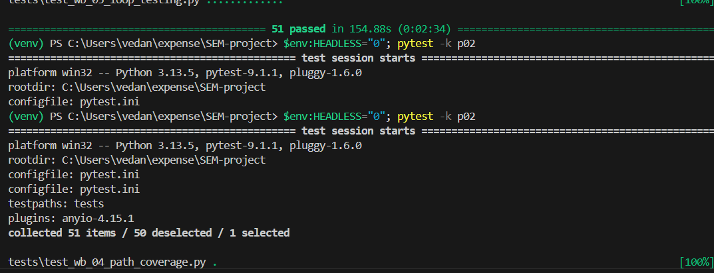
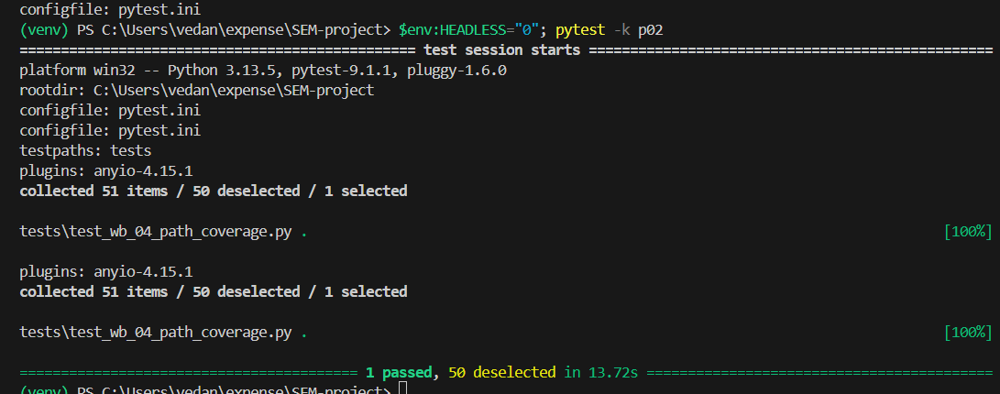

# Assignment 7: Test Report, White Box and Black Box Testing of UPIWhere

| | |
|---|---|
| **Course** | PBL III: CSE20140, TY CSE SEM V (AY 26-27) |
| **Application under test** | UPIWhere: Expense & Tag Tracker (FastAPI + SQLite backend, HTML/JS single-page frontend) |
| **Test tools** | Selenium WebDriver 4 (Python), pytest 9.1.1, coverage.py |
| **Test environment** | Windows (win32), Python 3.13.5, Google Chrome; also run on Linux with headless Chromium |
| **Test suite** | 51 automated test cases in `tests/` (`test_wb_01` … `test_wb_05`) |
| **Detailed design** | [`WHITE_BOX_TEST_PLAN.md`](WHITE_BOX_TEST_PLAN.md) (control-flow graphs, cyclomatic complexity, full test-case table) |

---

## 1. Aim

To check the correctness, functionality and quality of the UPIWhere web application in two ways:

- **White box testing**: test cases derived from the source code, so that statements,
  branches, conditions, paths and loops are exercised, with coverage measured.
- **Black box testing**: test cases derived from the requirements alone (inputs and expected
  outputs, without looking at the code), automated with Selenium.

---

## 2. Summary of results

| Run | Command | Mode | Result | Time | Evidence |
|---|---|---|---|---|---|
| 1 | `pytest` | Headless, full suite | **50 passed, 1 failed** | 140.61 s | Fig. 1 |
| 2 | `pytest` | Headless, full suite | **51 passed** | 154.88 s | Fig. 2 (top) |
| 3 | `$env:HEADLESS="0"; pytest -k p02` | Visible Chrome, single test | **1 passed** (50 deselected by `-k`) | 13.72 s | Fig. 2 (bottom), Fig. 3 |

**Final status: 51 of 51 test cases pass.** The only failure (Run 1) was a timing problem in the
test code, not a defect in the application (see §5.2).

**Code coverage** (measured with `coverage run --branch` during the Linux run; Windows runs
did not produce a coverage report, see §7):

| Module | Statements | Branches | Coverage |
|---|---|---|---|
| `crud.py` | 223 | 86 | 94% |
| `main.py` | 183 | 52 | 92% |
| `pdf_parser.py` | 125 | 42 | 80% |
| `database.py`, `models.py`, `schemas.py` | 154 | 0 | 100% |
| `seed_data.py` | 10 | 0 | 90% |
| **Total** | **695** | **180** | **92%** |

---

## 3. White box testing

White box tests were designed by reading the code: each test targets a specific decision,
condition, path or loop and names it in its docstring. Selenium drives the real UI, the tests
also read the page's internal JavaScript `state`, and coverage.py measures which backend lines
and branches ran.

| Technique | Test file | Tests | Example of what is covered |
|---|---|---|---|
| Statement coverage | `test_wb_01_statement_coverage.py` | 5 | Empty dashboard, add expense / tag / rule through the forms |
| Branch coverage | `test_wb_02_branch_coverage.py` | 14 | Untagged banner hidden / "1 expense" / "2 expenses"; confirm dialog OK vs Cancel; 404 branches |
| Condition coverage (MC/DC) | `test_wb_03_condition_coverage.py` | 12 | Search `name OR notes OR tag`; import duplicate check `amount AND type AND account AND time` |
| Path coverage | `test_wb_04_path_coverage.py` | 7 | Full GPay PDF import → preview → confirm, then the duplicate path; rule lifecycle |
| Loop testing | `test_wb_05_loop_testing.py` | 13 | Recent list with 0 / 1 / 4 / 5 / 6 items (limit 5); 7-day trend loop; early `break` in rule loop |

**Cyclomatic complexity** (manual control-flow analysis, details in the test plan):

| Function | Decisions | V(G) | Independent paths tested |
|---|---|---|---|
| `main.create_rule()` | 4 | 5 | 5 / 5 |
| `crud.create_transaction()` | 5 | 6 | 5 / 6 (1 path is unreachable, see §6) |
| `main.confirm_import_transactions()` | 4 | 5 | All, plus MC/DC on the duplicate condition |

---

## 4. Black box testing

The same Selenium suite was also used for black box testing. Each case below is defined only by
**input → expected output** from the user's point of view. The table maps every black box
technique in the assignment to the automated test that checks it.

### 4.1 Black box test cases

| ID | Technique | Requirement / scenario | Input | Expected output | Test | Result |
|---|---|---|---|---|---|---|
| BB-01 | Equivalence partitioning | Filter history by type | All / Debits / Credits | Only matching transactions shown | WB-C05 | Pass |
| BB-02 | Equivalence partitioning | Dashboard date range | Week / Month / Year / All Time | Totals 100 / 300 / 700 / 1500 | WB-P06 | Pass |
| BB-03 | Equivalence partitioning | Statement upload file type | `.txt` / corrupt `.pdf` / PDF with no rows / valid GPay PDF | Three different error messages; valid file is imported | WB-B11, WB-P02 | Pass |
| BB-04 | Boundary value analysis | "Recent transactions" shows at most 5 | 0, 1, 4, 5, 6 transactions | 0, 1, 4, 5, 5 rows | WB-L01 | Pass |
| BB-05 | Boundary value analysis | Duplicate import window is 5 minutes | Same entry +4 min / +10 min | Skipped / imported | WB-C06 | Pass |
| BB-06 | Boundary value analysis | Duplicate import needs the exact amount | ₹450 vs ₹451 | Second one is imported | WB-C06 | Pass |
| BB-07 | Decision table | Create auto-tag rule | Rule type × tag chosen × keyword already exists | Error "tag_id is required" / error "already exists" / rule created | WB-B06, WB-B07, WB-S05 | Pass |
| BB-08 | Decision table | Auto-tag a new expense | Rule match × tag already chosen × ignore rule | Auto-tagged / manual tag kept / hidden | WB-C02, WB-C03, WB-C04 | Pass |
| BB-09 | State transition | Theme | Light → Dark → reload → Light | Theme switches and is remembered after reload | WB-B09 | Pass |
| BB-10 | State transition | Transaction tag | Untagged → Travel → Untagged | Tag set, then cleared | WB-P05 | Pass |
| BB-11 | State transition | Transaction visibility | Visible → ignore rule → rule deleted | Hidden, then visible again | WB-P03 | Pass |
| BB-12 | Use case | Add an expense manually | ₹499.50, "Cafe Coffee Day" | Success message; total ₹499.50; listed in recent | WB-S03 | Pass |
| BB-13 | Use case | Import a GPay statement | Upload PDF with 2 entries, confirm | "Successfully imported 2 transaction(s)."; auto-tagged | WB-P02 | Pass |
| BB-14 | Use case | Manage tags | Create, rename, delete a tag | Tag cards update; deleted tag's expenses become untagged | WB-S04, WB-B04, WB-P04 | Pass |
| BB-15 | Error guessing | Duplicate tag name, different case/spaces | "  fOOd  " when "Food" exists | Error "Tag with this name already exists" | WB-B05 | Pass |
| BB-16 | Error guessing | Duplicate rule keyword with spaces | " swiggy " when SWIGGY exists | Error "already exists" | WB-B07 | Pass |
| BB-17 | Error guessing | Cancel destructive actions | Cancel on "Delete?" / "Clear all data?" | Nothing is deleted | WB-B03, WB-B12 | Pass |
| BB-18 | Error guessing | Import the same statement twice | Upload same PDF again | All rows marked Duplicate and unselected; confirming shows an error | WB-P02 | Pass |

### 4.2 Execution evidence (Selenium automation)

**Figure 1: Run 1, full suite (headless): 50 passed, 1 failed in 140.61 s**

`test_wb_c04_ignore_rule_condition_hides_transaction` failed with
`StaleElementReferenceException`. See §5.2 for the analysis.

**Figure 2: Run 2, full suite: 51 passed in 154.88 s; then Run 3 started in visible-Chrome mode**

**Figure 3: Run 3, visible Chrome (`HEADLESS=0`), GPay PDF import path: 1 passed in 13.72 s**

"50 deselected" is expected: `-k p02` runs only the selected test.

---

## 5. Defects and issues

### 5.1 Application defects found by testing

| # | Severity | Defect | Found by |
|---|---|---|---|
| D1 | Medium | **Editing a transaction is unreachable.** The edit form and `PUT /api/transactions/{id}` exist, but no button opens the form in edit mode. | WB-B13 (white box) |
| D2 | Medium | **Overlapping rules: the first rule wins, not the most specific.** With `UBER` → Transport and `UBER EATS` → Food, "Uber Eats Order" is tagged Transport. | WB-L03, BB-08 |
| D3 | Low | **Deleting a tag rule does not untag the expenses it tagged.** | WB-P03 |
| D4 | Low | **Server-side filters are never used by the UI.** The UI filters in the browser, so those backend branches are only reachable through the API. | WB-B14 |

### 5.2 Test-script issue from Run 1 (not an application defect)

- **Symptom:** `test_wb_c04` raised `StaleElementReferenceException: stale element not found`.
- **Root cause:** a timing race in the test helper. The previous "Transaction created!" message
  was still on screen. The helper found that message element, and the app replaced it with a new
  message before the helper finished reading it. Run 2 passed with no changes, which confirms it
  was timing-dependent.
- **Fix:** in `tests/conftest.py`, the helper now reads each message in a single step, and tests
  wait until the app has finished reloading its data before the next action.

---

## 6. Observations

- **Unreachable path:** in `crud.create_transaction()`, `if acc_name:` can never be false from the
  UI, because the sender always defaults to `"MANUAL"`. 100% path coverage is impossible here.
- **Remaining uncovered code (8%):** startup and migration fallbacks, the `__main__` launcher,
  the check for a missing PDF library, password-protected PDFs, and alternative date formats.

---

## 7. Conclusion

All **51 automated test cases pass**. White box tests reached **92% statement and branch
coverage** of the backend. Black box test cases covering equivalence partitioning, boundary
values, decision tables, state transitions, use cases and error guessing confirmed that UPIWhere
behaves as expected from the user's side. Testing found **4 application defects** (§5.1) and
one flaky test, which has been fixed (§5.2).

Neither approach is enough on its own. Black box testing could not have revealed the unreachable
edit feature (D1), and white box testing alone would not ask whether that feature is required.

> **Note for Windows:** the test server is stopped with `terminate()` on Windows, so coverage.py
> does not save data there. The coverage figures above come from the Linux run.
