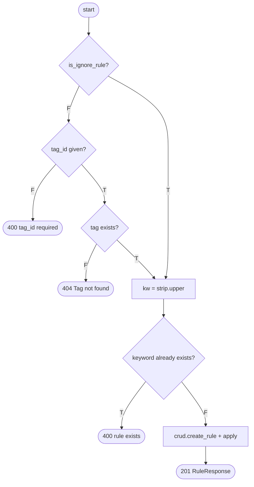

# Assignment 7: White-Box Testing of *Financial Clarity* with Selenium (Python)

**Application under test:** Financial Clarity, the expense tracker and tag manager in this repo
(FastAPI backend in `backend/`, vanilla-JS single-page app in `frontend/`).
**Tools:** Selenium WebDriver 4 (Python), pytest, coverage.py (statement + branch).

## 1. Approach

White-box testing starts from the source code. We read the code first, picked the
decisions, conditions, paths and loops to exercise, and then wrote Selenium tests that
drive the real UI in Chrome along those paths. The approach has three parts:

| Part | How it is done |
|---|---|
| **Test design from code** | Each test's docstring names the function and the decision, condition, path or loop it targets (e.g. `crud.create_transaction: if not is_tagged -> F`). |
| **Internal-state assertions** | Besides checking what is visible, tests read the SPA's internal JS `state` object (`driver.execute_script("return state.activeFilter")`). A pure black-box tester could not do this. |
| **Measured coverage** | `tests/conftest.py` runs the backend under `coverage run --branch`. Each test run prints statement and branch coverage for `backend/*.py` and writes an HTML report showing which lines and branches the Selenium tests executed. |

Paths that the UI cannot reach (for example 404s for IDs that never come from the
server) are driven through the REST layer in the same test session and are marked as such.

## 2. Control-flow analysis (manual white-box part)

V(G) = number of decision points + 1 = E − N + 2. It gives the number of independent
(basis) paths that must be tested.

### 2.1 `main.create_rule()` (backend/main.py)



4 decisions → **V(G) = 5**

| Basis path | Route | Test |
|---|---|---|
| P1 | D1=F, D2=F → 400 | WB-B06 |
| P2 | D1=F, D2=T, D3=F → 404 | WB-B08 |
| P3 | D1=F, D2=T, D3=T, D4=T → 400 | WB-B07 |
| P4 | D1=F, D2=T, D3=T, D4=F → 201 | WB-S05 |
| P5 | D1=T, D4=F → 201 (ignore rule) | WB-B06 |

### 2.2 `crud.create_transaction()` (backend/crud.py)

```
1  ts = timestamp or now ; acc_name = account_name or sender_address
2  tag_id = input ; is_tagged = tag_id is not None ; is_ignored = False
3  if acc_name:                                   ── D1
4      for r in rules:                            ── D2 (loop)
5          if r.kw and (kw in acc_name or kw in raw_message):   ── D3 (compound)
6              if r.is_ignore_rule:               ── D4
7                  is_ignored = True; tag_id = None; is_tagged = False
8              else:
9                  if not is_tagged:              ── D5
10                     tag_id = r.tag_id; is_tagged = True
11             break
12 insert row; return enriched row
```

5 decisions → **V(G) = 6**

| Basis path | Route | Test |
|---|---|---|
| P1 | D1=F (no account/sender) | infeasible from the UI: `sender_address` defaults to `"MANUAL"`, so `acc_name` is always truthy |
| P2 | D1=T, loop runs 0 times (no rules) | WB-L03 [no rules] |
| P3 | D1=T, loop runs, D3 always F | WB-L03 [OLA/SWIGGY], WB-C02 case 3 |
| P4 | D3=T, D4=T (ignore rule) | WB-C04 |
| P5 | D3=T, D4=F, D5=T (auto-tag) | WB-C02 cases 1–2, WB-L03 [UBER] |
| P6 | D3=T, D4=F, D5=F (manual tag kept) | WB-C03 |

Condition coverage of D3 (`kw in acc_name` / `kw in raw_message`): WB-C02 makes each
operand true on its own, then both false.

### 2.3 `main.confirm_import_transactions()`: de-duplication decision

`same_amt AND same_type AND same_account AND same_time` → skip insert.
MC/DC table (WB-C06). Each row flips exactly one condition from the all-true baseline:

| Case | amt | type | account | time | Duplicate? | Rows inserted |
|---|---|---|---|---|---|---|
| identical | T | T | T | T | yes | 0 |
| amount 451 vs 450 | **F** | T | T | T | no | 1 |
| CREDIT vs DEBIT | T | **F** | T | T | no | 1 |
| "Pizza Hut" vs "Dominos" | T | T | **F** | T | no | 1 |
| "  DOMINOS " (case/space) | T | T | T | T | yes | 0 |
| +10 min | T | T | T | **F** | no | 1 |
| +4 min (inside 5-min window) | T | T | T | T | yes | 0 |

### 2.4 Front-end decisions (frontend/js/app.js)

| Function | Decision(s) | Tests |
|---|---|---|
| `renderDashboard` | `untagged_count > 0`, plural `> 1`, `top_expenditure` null | WB-B01, WB-B02, WB-S01 |
| `renderHistory` | type filter, `untagged` / tag-id filter, search `A‖B‖C`, TODAY/YESTERDAY/EARLIER grouping | WB-C01, WB-C05, WB-P01 |
| `getRangeTimestamps` | `all` / `week` / `month` / `year` | WB-P06 |
| `handleTransactionSubmit` / `handleTagSubmit` | `if (editId)` create vs update | WB-S03, WB-B13, WB-S04, WB-B04 |
| `handleRuleSubmit` + radio listener | IGNORE vs TAG | WB-B06 |
| `handlePDFFile` / `handleConfirmPDFImport` | non-PDF, parse error, nothing selected | WB-B11, WB-P02 |
| delete / clear-data handlers | `confirm()` true / false | WB-B03, WB-B12 |
| `toggleTheme` / `initTheme` | dark / light, persisted | WB-B09 |
| `switchTxModalMode` | pdf / manual | WB-B10 |

## 3. Test cases

| ID | Technique | Unit under test | Input / action | Expected result | Result |
|---|---|---|---|---|---|
| WB-S01 | Statement | `get_dashboard_stats`, `renderDashboard` | Empty DB, open app | ₹0.00, top "None", 7 zero bars, no donut segments | Pass |
| WB-S02 | Statement | `renderHistory/Tags/Rules` | Empty DB, visit each tab | Empty-state messages | Pass |
| WB-S03 | Statement | `handleTransactionSubmit` → `crud.create_transaction` | Add ₹499.50 "Cafe Coffee Day" via modal | Toast, total ₹499.50, "Untagged" placeholder | Pass |
| WB-S04 | Statement | `handleTagSubmit` → `create_tag` | Add tag "Groceries" | Tag card, pill and dropdown options appear | Pass |
| WB-S05 | Statement | `handleRuleSubmit` → `create_rule` | Rule "  zomato " → Food | Stored as "ZOMATO" | Pass |
| WB-B01 | Branch | untagged banner | 0, 1, 2 untagged debits | hidden / "1 expense" / "2 expenses" | Pass |
| WB-B02 | Branch | top expense | Credit only, then debits | "None", then largest debit; credits not counted | Pass |
| WB-B03 | Branch | delete tx `confirm()` | Cancel, then OK | Kept, then soft-deleted | Pass |
| WB-B04 | Branch | tag edit path | Edit "Travl" → "Travel" | "Edit Tag" title, updated not duplicated | Pass |
| WB-B05 | Branch | duplicate tag | "  fOOd  " when "Food" exists | Error toast "already exists" | Pass |
| WB-B06 | Branch | rule TAG without tag / IGNORE | Submit with no tags; then ignore rule | 400 toast; ignore rule created | Pass |
| WB-B07 | Branch | duplicate rule | " swiggy " when SWIGGY exists | Error toast | Pass |
| WB-B08 | Branch | 404 branches (API) | Missing IDs on all PUT/DELETE; rule with bad tag | 404 each | Pass |
| WB-B09 | Branch | theme | Toggle, reload, toggle | dark ↔ light, persisted in localStorage | Pass |
| WB-B10 | Branch | modal mode | PDF / manual buttons | Correct panel shown | Pass |
| WB-B11 | Branch | PDF errors | .txt, corrupt .pdf, PDF with no rows | 3 different error toasts | Pass |
| WB-B12 | Branch | clear data `confirm()` | Cancel, then OK | Kept, then all cleared | Pass |
| WB-B13 | Branch | tx edit path | `openTransactionModal(tx)` then save | All fields updated | Pass |
| WB-B14 | Branch | server-side filters (API) | start/end/type/untagged/tag/search | Correct subsets | Pass |
| WB-C01 | Condition | history search `A‖B‖C` | "zomato", "birthday", "food", "xyz" | One match per operand, then none | Pass |
| WB-C02 | Condition | rule match (account ‖ notes) | 3 transactions | tagged, tagged, untagged | Pass |
| WB-C03 | Condition | `if not is_tagged` | Manual tag + matching rule | Manual tag kept | Pass |
| WB-C04 | Condition | ignore rule | "Self Transfer HDFC" | Hidden from list and totals | Pass |
| WB-C05 | Condition | type + tag filters | Debit / Credit / Untagged / tag pill | Correct rows | Pass |
| WB-C06 | Condition (MC/DC) | import de-dup | 7 cases in §2.3 | As per table | Pass |
| WB-P01 | Path | history grouping | today / yesterday / 10 days ago | 3 groups in order | Pass |
| WB-P02 | Path | full PDF import + duplicate path | Upload same GPay PDF twice | 2 imported + auto-tagged; then 2 duplicates, unchecked | Pass |
| WB-P03 | Path | `reevaluate_all_transactions` | create / delete tag rule, ignore rule, Apply Rules | Tag applied; kept; hidden; restored; re-applied | Pass |
| WB-P04 | Path | `delete_tag` | Delete tag in use | Transaction untagged, banner shown | Pass |
| WB-P05 | Path | inline tag selector | Set tag, then Untagged | `is_tagged` true → false | Pass |
| WB-P06 | Path | `getRangeTimestamps` | week / month / year / all | 100 / 300 / 700 / 1500 | Pass |
| WB-P07 | Path | "Review" banner button | Click | History tab with untagged filter | Pass |
| WB-L01 | Loop | recent list `slice(0,5)` | 0, 1, 4, 5, 6 transactions | 0, 1, 4, 5, 5 rows | Pass |
| WB-L02 | Loop | 7-day trend loop | Debits today and 2 days ago, plus a credit | 7 bars, 100% / 20%, credit excluded | Pass |
| WB-L03 | Loop | rule loop with `break` | 0 / 1 / many / overlapping rules | First matching rule wins | Pass |
| WB-L04 | Loop | donut segments | 1 and 3 categories | n segments, hover label | Pass |
| WB-L05 | Loop | tag cards | 0 / 1 / 3 transactions per tag | Correct singular/plural | Pass |

**Run summary:** 51 tests, 51 passed.

Backend coverage measured during the Selenium run (`coverage run --branch`):

| Module | Statements | Missed | Branches | Partial | Cover |
|---|---|---|---|---|---|
| crud.py | 223 | 6 | 86 | 14 | 94% |
| main.py | 183 | 13 | 52 | 3 | 92% |
| pdf_parser.py | 125 | 22 | 42 | 8 | 80% |
| database.py / models.py / schemas.py | 154 | 0 | 0 | 0 | 100% |
| seed_data.py | 10 | 1 | 0 | 0 | 90% |
| **Total** | **695** | **42** | **180** | **25** | **92%** |

Most of what is still missed is startup or environment code: schema-migration fallback,
`if __name__ == "__main__"`, the missing-pypdf import guard, encrypted-PDF password handling,
and the `strptime` fallback formats.

## 4. Observations / defects found

1. **Edit-transaction feature is unreachable (dead UI code).** `openTransactionModal(tx)`
   supports edit mode and the backend has `PUT /api/transactions/{id}`, but no button calls it
   with a transaction. WB-B13 tests the path by calling the function directly.
2. **Overlapping rules: the first match wins, not the most specific.** With rules `UBER` →
   Transport and `UBER EATS` → Food, "Uber Eats Order" is tagged Transport, because the loop
   stops at the first rule by insertion order (WB-L03).
3. **Deleting a tag rule does not untag the transactions it tagged.** Only ignore status is
   reset (WB-P03). This matches the code comment, but users may not expect it.
4. **Server-side filters are never used by the UI.** All filtering happens in the browser, so
   the filter branches in `crud.get_transactions` are only exercised through the API (WB-B14).
5. **Infeasible path:** `if acc_name:` in `create_transaction` can never be false from the UI,
   because `sender_address` defaults to `"MANUAL"` (§2.2, P1).

## 5. How to run

```bash
pip install -r requirements-test.txt
pytest                              # headless Chrome; prints the coverage table at the end
HEADLESS=0 pytest -k test_wb_p02    # watch one test in a visible browser
```

The HTML coverage report is written to `tests/reports/coverage_html/index.html`
(green = executed, red = missed, yellow = partially taken branch).

## 6. FAQ answers

**Why do we need both white-box and black-box testing? Can one replace the other?**
No, they find different defects. White-box testing found the unreachable edit path and the
infeasible `acc_name` branch, which a black-box tester cannot see. Black-box testing checks
behaviour against requirements, so it catches missing features that code-based tests never
look for.

**If a program gives the correct output for every test case, is it defect-free?**
No. Tests only show defects when they are present, not that none exist. Here, 92% branch-aware
coverage still leaves untested lines, and a passing test like WB-L03 can still describe
questionable behaviour (the less specific rule wins).

**How does knowing the source code influence the choice of technique?**
With the code, we can count decisions (V(G)), choose MC/DC inputs (§2.3), test loops at their
exact bounds (`slice(0, 5)`), and see that some paths are unreachable. Without it, we fall back
on equivalence partitioning and boundary values from the specification.

**Why is 100% testing difficult?**
Paths grow combinatorially with sequential decisions and loops. Some paths are infeasible
(§2.2, P1). Some depend on the environment (corrupt or encrypted PDFs, the clock, time zones).
Exhaustive input testing is impossible for real-valued amounts and free-text names.
