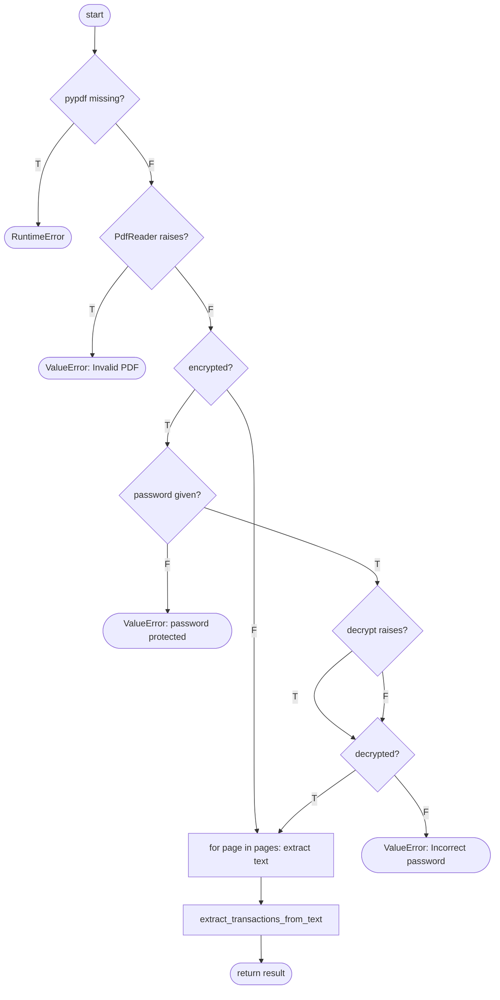

# Assignment 7: White Box Testing Report (Code-Level), UPIWhere

| | |
|---|---|
| **Course** | PBL III: CSE20140, TY CSE SEM V (AY 26-27) |
| **Application under test** | UPIWhere: Expense & Tag Tracker, backend (`backend/*.py`) |
| **Test suite** | `tests/whitebox/` (**96 test cases**, no browser) |
| **Companion report** | [`TEST_REPORT.md`](TEST_REPORT.md) (Selenium suite, black box view) |
| **Result** | **96 / 96 passed** in about 2.2 s, **98% statement + branch coverage** |

---

## 1. Aim

To check the internal logic of the UPIWhere backend by designing test cases from its source code
(control-flow analysis, cyclomatic complexity, basis paths) and executing them directly against
the Python functions. The goal is to cover the branches, conditions and loops that the browser
cannot reach.

**How this differs from the Selenium suite**

| | Selenium suite (`tests/test_wb_0*.py`) | Code-level suite (`tests/whitebox/`) |
|---|---|---|
| Drives | The real UI in Chrome | Python functions and API routes directly |
| Inputs | Only what a user can type or click | Any input, including ones the UI never sends |
| Speed | About 2.5 min | About 2 s |
| Backend coverage | 92% | **98%** |

---

## 2. Libraries used

| Library | Version used | Purpose in testing |
|---|---|---|
| **pytest** | 9.1.1 | Test runner, fixtures, `parametrize` for equivalence classes and boundaries, `monkeypatch` to force error branches |
| **pytest-cov** | 7.1.0 | Runs coverage.py inside pytest (`--cov --cov-branch`) |
| **coverage.py** | 7.16.2 | Measures statement and branch coverage; HTML report |
| **FastAPI TestClient** (Starlette) | FastAPI 0.142.2 | Calls every API route in-process, with no server needed |
| **httpx** | 0.28.1 | HTTP client used by the TestClient |
| **pypdf** | 6.19.0 | Builds password-protected PDFs to test the decryption branches |
| **SQLAlchemy** | 2.1.3 | Database session per test (throwaway SQLite file via `FC_DB_PATH`) |
| **Selenium WebDriver** | 4.50.0 | Used only by the companion browser suite |
| `tests/pdf_factory.py` | (project helper) | Generates small valid GPay-style statement PDFs |

---

## 3. Units selected for white box testing

| Unit | File | Why it was selected |
|---|---|---|
| `parse_gpay_pdf()` | `pdf_parser.py` | 7 decisions; error branches (corrupt or encrypted PDFs) the UI rarely hits |
| `extract_transactions_from_text()` | `pdf_parser.py` | Most complex function (V(G) = 17): nested loops, 6 regexes, an 8-line look-ahead, in-PDF duplicate check |
| `parse_datetime_to_epoch()` | `pdf_parser.py` | Loop over 5 date formats plus a fallback |
| `create_transaction()` | `crud.py` | Auto-tag and ignore rule logic, V(G) = 6 |
| `reevaluate_all_transactions()`, `apply_single_rule_to_existing()` | `crud.py` | Rule application paths |
| `get_dashboard_stats()` | `crud.py` | Arithmetic, percentages, divide-by-zero guards, 7-day loop |
| `create_rule()`, `parse_gpay_pdf_endpoint()`, `confirm_import_transactions()` | `main.py` | All 400/404 exits; duplicate detection against the database |

---

## 4. Control-flow analysis

V(G) = number of decision (predicate) nodes + 1. It equals the number of independent basis paths.

### 4.1 `parse_gpay_pdf()`, V(G) = 8



| Basis path | Route | Test |
|---|---|---|
| 1 | pypdf missing | WBU-P01 |
| 2 | corrupt bytes | WBU-P02 |
| 3 | not encrypted → parse | WBU-P03 |
| 4 | encrypted, no password | WBU-P04 |
| 5 | encrypted, wrong password | WBU-P05 |
| 6 | encrypted, decrypt raises | WBU-P06 |
| 7 | encrypted, correct password → parse | WBU-P07 |
| 8 | page loop with 0 pages | Not tested (a statement always has at least one page) |

### 4.2 `extract_transactions_from_text()`, V(G) = 17

The 16 decision nodes are: the outer `while`, `if date_match`, the inner look-ahead `while`, the
`break` on the next date, the time / amount / UPI / paid / received / self-transfer `if`s,
`except ValueError`, `if amount_val > 0 and merchant_name`, `if upi_id`, the `for prev` loop, the
duplicate `if`, and `if not is_batch_dup`.

| Group of paths | What is exercised | Tests |
|---|---|---|
| Detail-line paths | Paid to / Payment to / Received from / Cashback / Refund / Self transfer | WBU-E01 (6 cases) |
| Field paths | merged PDF text, camelCase split, UPI present/absent, missing time, amount formats, `ValueError` branch | WBU-E02 … E06 |
| Compound conditions | `amount > 0 and merchant`, first amount/merchant wins, in-PDF duplicate rule | WBU-C01 … C03 |
| Loops | 0 lines, non-date lines, many entries, look-ahead bound 8 vs 9, stop at next date | WBU-L01 … L05 |

**MC/DC for the in-PDF duplicate rule** `same_upi OR (same_amt AND same_acc AND same_time)` (WBU-C03):

| Case | same_upi | same_amt | same_acc | same_time | Duplicate? |
|---|---|---|---|---|---|
| same UPI id | **T** | T | T | T | yes |
| different UPI, rest equal | F | T | T | T | yes |
| amount differs | F | **F** | T | T | no |
| merchant differs | F | T | **F** | T | no |
| 12 hours apart | F | T | T | **F** | no |
| no UPI at all | F | T | T | T | yes |

### 4.3 `crud.create_transaction()`, V(G) = 6

| Basis path | Route | Test |
|---|---|---|
| P1 | `if acc_name` F | WBU-T01: **reachable here** (empty sender), unreachable from the UI |
| P2 | rule loop runs 0 times | WBU-T02 |
| P3 | rules present, none match | WBU-T03 |
| P4 | match, ignore rule | WBU-T04 |
| P5 | match, tag rule, not tagged | WBU-T05 |
| P6 | match, tag rule, already tagged | WBU-T06 |

### 4.4 `main.create_rule()`, V(G) = 5

All 5 basis paths are tested (WBU-A01 … A05): missing tag_id → 400, unknown tag → 404,
duplicate keyword → 400, tag rule → 201, ignore rule → 201.

### 4.5 `crud.get_dashboard_stats()`: boundary and branch table

| Decision / boundary | Values tested | Test |
|---|---|---|
| no debits → `top = None`, `anchor = now`, `max_day == 0 → 1.0` | empty DB | WBU-S01 |
| `pct if total_expenditure > 0 else 0.0` | a ₹0 debit (only way to reach the F branch) | WBU-S02 |
| category: real tag / untagged (-1) / tag deleted / emoji NULL | 4 categories | WBU-S03 |
| 7-day loop window | 00:00:00 and 23:59:59 included; 7 days back excluded | WBU-S04 |
| `start_ts` / `end_ts` filters | start, end, both | WBU-S05 |
| deleted and ignored rows excluded | soft delete + ignore rule | WBU-S06 |

---

## 5. Tests performed

### 5.1 `tests/whitebox/test_pdf_parser.py` (41 tests)

| ID | Technique | Test performed | Expected |
|---|---|---|---|
| WBU-P01 | Branch | pypdf library missing | `RuntimeError` |
| WBU-P02 | Branch | Corrupt bytes | `ValueError("Invalid PDF file…")` |
| WBU-P03 | Path | Plain, valid PDF | 1 transaction extracted |
| WBU-P04 | Branch | Encrypted PDF, no password | "password protected" |
| WBU-P05 | Branch | Encrypted PDF, wrong password | "Incorrect PDF password." |
| WBU-P06 | Branch | `decrypt()` raises (monkeypatched) | "Incorrect PDF password." |
| WBU-P07 | Path | Encrypted PDF, correct password | 1 transaction extracted |
| WBU-E01 | Path (×6) | Each detail-line pattern | Correct DEBIT/CREDIT and merchant |
| WBU-E02 | Path | Un-spaced text `13Sep,2026`, `PaidtoZomatoOnlineOrder`, `₹89` | "Zomato Online Order", ₹89 |
| WBU-E03 | Branch | With and without UPI id | Suffix " \| UPI ID: …" only when present |
| WBU-E04 | Branch | No time line | Defaults to 12:00 PM |
| WBU-E05 | Equivalence (×4) | `₹2,000`, `₹327.56`, `$50.00`, `Rs. 89` | 2000, 327.56, 50, 89 |
| WBU-E06 | Branch | Amount line `$,` then `$75` | `ValueError` swallowed; 75 used |
| WBU-C01 | Condition | No amount / no merchant / both | Only "both" extracted |
| WBU-C02 | Condition | Two merchants and two amounts | First of each wins |
| WBU-C03 | MC/DC (×6) | In-PDF duplicate rule (table §4.2) | As per table |
| WBU-L01 | Loop: 0 | Empty / blank text | `[]` |
| WBU-L02 | Loop | Only non-date lines | `[]` |
| WBU-L03 | Loop: many | 5 entries | 5 transactions in order |
| WBU-L04 | Loop bound (×2) | Amount on look-ahead line 8 vs 9 | Found / dropped |
| WBU-L05 | Loop exit | Next date before an amount | Look-ahead stops; no leak between entries |
| WBU-D01 | Loop (×5) | One input per date format | Correct epoch for each |
| WBU-D02 | Loop: all fail | Unparseable date | Falls back to current time |

### 5.2 `tests/whitebox/test_crud.py` (30 tests)

| ID | Technique | Test performed | Expected |
|---|---|---|---|
| WBU-T01 … T06 | Basis paths | `create_transaction` paths P1–P6 (§4.3) | Untagged / auto-tagged / manual kept / ignored |
| WBU-T07 | Condition (×4) | Keyword in account / in notes / notes empty / neither | Tagged, tagged, untagged, untagged |
| WBU-T08 | Loop `break` | Rules `UBER` then `UBER EATS` | First rule wins (**defect D2**) |
| WBU-T09 | Branch | Missing timestamp / account name, lowercase type | Defaults applied |
| WBU-R01 | Path | Create rule `"  zomato "` | Stored "ZOMATO", applied to existing rows |
| WBU-R02 | Branch | Apply rule with 0 matches; tag; ignore | Count 0 / 2 / 2 |
| WBU-R03 | Path | Re-evaluate: no match / sender fallback / notes match → ignore | Each path's result |
| WBU-R04 | Branch | Delete missing / existing rule | False / True |
| WBU-R05 | Branch | List rules with and without a tag | Tag name / `None` |
| WBU-R06 | Statement | Apply-all count excludes deleted rows | 2 |
| WBU-U01 | Branch | `update_tag` with no fields / all fields / missing id | Unchanged / updated / `None` |
| WBU-U02 | Path | Delete a tag that is in use | Transaction untagged |
| WBU-U03 | Branch | `update_transaction` with no fields / all 7 fields / missing id | Unchanged / updated / `None` |
| WBU-U04 | Branch | Tag set → cleared, delete, missing ids | `is_tagged` T → F, soft-delete |
| WBU-U05 | Branch | Transaction pointing at a deleted tag | `tag_name` `None` |
| WBU-F01 | Branch | Every `get_transactions` filter, and `untagged_only` + `tag_id` together | Correct subsets; `untagged_only` wins |
| WBU-S01 … S06 | Branch / BVA / Loop | Dashboard (§4.5) | As per table |

### 5.3 `tests/whitebox/test_api.py` (25 tests)

| ID | Technique | Test performed | Expected |
|---|---|---|---|
| WBU-A01 … A05 | Basis paths | `create_rule` paths 1–5 | 400 / 404 / 400 / 201 / 201 |
| WBU-A06 | Branch (×6) | PUT/DELETE on missing transaction, tag, rule | 404 each |
| WBU-A07 | Statement | Success path of every simple route | 200/201 with correct body |
| WBU-A08 | Branch | Duplicate tag `"  FOOD "` | 400 "already exists" |
| WBU-A09 | Branch | `/` and `/favicon.ico` (no icon file) | 200 HTML / 204 |
| WBU-A10 | Branch | Upload `notes.txt` | 400 "File must be a PDF" |
| WBU-A11 | Branch | Upload corrupt PDF | 400 "Invalid PDF file" |
| WBU-A12 | Branch | Upload PDF with no transactions | 400 "No transaction records…" |
| WBU-A13 | Path | Upload statement with a matching rule | 2 new, row 1 auto-tagged Food |
| WBU-A14 | MC/DC (×6) | Duplicate against the database: `upi OR (amt AND type AND account AND time)` | dup / dup / new / new / new / new |
| WBU-A15 | Loop | Confirm import: 2 new → same again → 1 new → empty list | 2 / 0 / 1 / 0 imported |

---

## 6. Results

### 6.1 Execution summary

| Suite | Tests | Passed | Failed | Time |
|---|---|---|---|---|
| `test_pdf_parser.py` | 41 | 41 | 0 | |
| `test_crud.py` | 30 | 30 | 0 | |
| `test_api.py` | 25 | 25 | 0 | |
| **Total** | **96** | **96** | **0** | **about 2.2 s** |

### 6.2 Coverage (statement + branch)

| Module | Statements | Branches | Selenium suite | **Code-level suite** | Still uncovered |
|---|---|---|---|---|---|
| `crud.py` | 223 | 86 | 94% | **100%** | none |
| `main.py` | 183 | 52 | 92% | **95%** | startup DB-repair code, favicon present, `__main__` |
| `pdf_parser.py` | 125 | 42 | 80% | **99%** | `except ImportError` when pypdf is missing at import |
| `seed_data.py` | 10 | 0 | 90% | **100%** | none |
| `database.py`, `models.py`, `schemas.py` | 154 | 0 | 100% | **100%** | none |
| **Total** | **695** | **180** | **92%** | **98%** | 11 statements, 3 partial branches |

The remaining 2% runs once at import or server start-up (schema recovery, the `__main__`
launcher, an optional-import fallback). These lines can only be reached by changing the
environment, not by inputs.

### 6.3 Screenshots

Run `pytest tests/whitebox --cov=backend --cov-branch --cov-report=term-missing --cov-report=html:tests/reports/unit_coverage_html`,
take screenshots, save them in `tests/screenshots/`, and they will appear below:

**Figure 1: pytest output (96 passed) with the coverage table**


**Figure 2: HTML coverage report (`tests/reports/unit_coverage_html/index.html`)**


---

## 7. Defects and observations

| # | Type | Finding | Evidence |
|---|---|---|---|
| D2 | Defect (logic) | Overlapping rules: the first rule created wins, not the most specific (`UBER` beats `UBER EATS`). | WBU-T08 |
| O1 | Hidden behaviour | Creating a tag with `emoji = None` silently stores the default 🏷️, so the dashboard's `emoji or "📦"` fallback only runs for NULLs written directly to the database. Found when the first version of WBU-S03 failed. | WBU-S03 |
| O2 | Path feasibility | `if acc_name:` (P1) is unreachable from the UI but reachable through the code (empty sender). Unit tests can cover paths the browser cannot. | WBU-T01 |
| O3 | Design limit | A statement entry whose amount is more than 8 lines below its date is silently skipped. | WBU-L04 |
| O4 | Design choice | If both `untagged_only` and `tag_id` are given, `untagged_only` takes priority (`if` / `elif`). | WBU-F01 |
| O5 | Boundary | The dashboard's "0%" category branch can only be reached with a ₹0 debit. | WBU-S02 |

---

## 8. How to run

```bash
pip install -r requirements-test.txt

pytest tests/whitebox                                                    # code-level suite only (~2 s)
pytest tests/whitebox --cov=backend --cov-branch --cov-report=term-missing   # + coverage table
pytest tests/whitebox --cov=backend --cov-branch --cov-report=html:tests/reports/unit_coverage_html
pytest tests/whitebox -v                                                 # list every test by name
pytest                                                                   # both suites (147 tests)
```

The code-level suite runs in-process, so its coverage report also works on **Windows**. The
Selenium suite's coverage does not (see `TEST_REPORT.md` §7).

---

## 9. Conclusion

Code-level white box testing executed **96 test cases with 0 failures** and raised backend
coverage from 92% (Selenium suite) to **98% statement + branch coverage**. `crud.py` reached
100%. 7 of 8 basis paths of `parse_gpay_pdf` were executed (the zero-page path is not tested),
as were all 6 of `create_transaction` and all 5 of `create_rule`. Both duplicate-detection rules
were verified with MC/DC. The approach also showed things UI testing could not: a path
unreachable from the browser (O2), silent default substitution (O1), and the look-ahead limit
of the PDF parser (O3).
